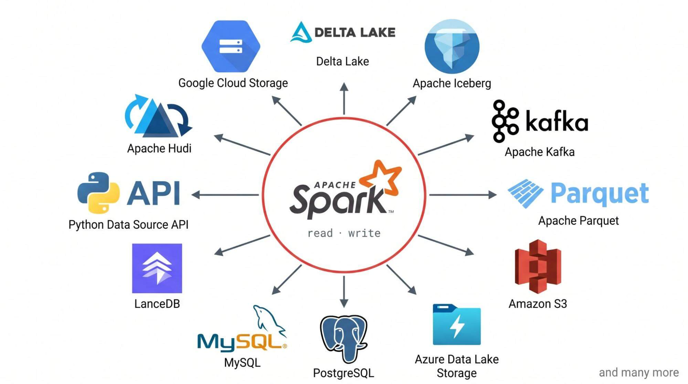

# Funciones anónimas en Scala, Java y Python

Este repositorio reúne ejemplos de funciones anónimas aplicadas a listas y colecciones. El trabajo usa los mismos productos para resolver ejercicios en Scala, Java y Python, y comparar cómo se escribe una idea parecida en cada lenguaje.

## Organización y ejecución

Los datos se definen una sola vez por lenguaje:

- Scala: [Datos.scala](scala/Datos.scala)
- Java: [Datos.java](java/Datos.java) y [Producto.java](java/Producto.java)
- Python: [datos.py](python/datos.py) y [producto.py](python/producto.py)

Los ejercicios están numerados igual en las tres carpetas. Por ejemplo, para ejecutar el ejercicio 1 desde la raíz del repositorio:

```bash
# Scala 3 con Scala CLI
scala run scala/Datos.scala scala/Ejemplo1.sc

# Java 16 o posterior
cd java
javac Producto.java Datos.java Ejemplo1.java
java Ejemplo1
cd ..

# Python 3.7 o posterior
python3 python/ejemplo1.py
```

Para probar otro ejercicio, cambia el número del nombre del archivo. Cada programa imprime su resultado en la consola. Scala usa definiciones y expresiones en orden; Java necesita una clase con `main` para ejecutar cada archivo; Python importa la lista de datos compartida.

## Parte 1 – Programación funcional en el mundo real



### Apache Spark

Apache Spark procesa conjuntos de datos distribuidos en varias partes de un clúster. Por ejemplo, un equipo puede usarlo para sumar o filtrar grandes cantidades de registros sin programar manualmente el recorrido de cada parte. La guía oficial muestra una reducción de un RDD con esta función:

```scala
distData.reduce((a, b) => a + b)
```

La función anónima suma dos valores; Spark aplica esa operación a los datos distribuidos. La guía también explica que los RDD pueden procesarse en paralelo y recuperarse ante fallos.

Fuente: [Apache Spark – RDD Programming Guide](https://spark.apache.org/docs/latest/rdd-programming-guide.html).


### pandas

pandas es una biblioteca de Python de código abierto para analizar datos tabulares. Una tarea común en ese tipo de análisis es agrupar filas —por ejemplo, ventas por categoría— y calcular un resumen para cada grupo. `groupby` permite hacer esa división y aplicar una operación de agregación.

Un ejemplo sencillo, suponiendo que `df` tiene columnas `categoria` y `precio`, sería calcular el precio promedio por categoría:

```python
promedios = df.groupby("categoria")["precio"].mean()
```

La operación muestra cómo agrupar y resumir datos en pandas; no forma parte de los programas del inventario de este repositorio.

Fuente: [pandas – Group by: split-apply-combine](https://pandas.pydata.org/docs/user_guide/groupby.html).

## Parte 2 – ¿Qué es una función anónima?

### ¿Qué es y por qué se llama lambda?

Una función anónima es una función que no necesita un nombre propio. Se escribe normalmente en el lugar donde se va a utilizar. En Scala, `p => p.precio > 100` recibe un producto y responde si su precio supera 100.

El nombre *lambda* viene de la notación del cálculo lambda, un sistema matemático para representar funciones y su aplicación.

### Diferencia entre una función nombrada y una anónima

Las dos expresiones siguientes aplican el mismo criterio. La primera función tiene un nombre y se puede reutilizar; la segunda se escribe directamente dentro de `filter`.

```scala
def esCaro(p: Producto): Boolean = p.precio > 100

val porNombre = productos.filter(esCaro)
val anonima = productos.filter(p => p.precio > 100)
```

### Funciones como valores

Una función es de primera clase cuando se puede guardar en una variable, pasar como argumento o devolver como resultado. Por eso podemos dar un criterio a `filter`:

```scala
val tienePocoStock: Producto => Boolean = p => p.stock < 10
val porReponer = productos.filter(tienePocoStock)
```

El tipo `Producto => Boolean` indica que la función recibe un `Producto` y devuelve `true` o `false`.

### Closure

Una función puede usar una variable definida fuera de ella. A esa función junto con el valor que mantiene disponible se le llama *closure*. En este ejemplo, la lambda usa `limite`:

```scala
val limite = 100.0
val productosCaros = productos.filter(p => p.precio > limite)
```

## Parte 3 – Problemas resueltos con funciones anónimas

Los ejemplos usan un inventario de 12 productos en cuatro categorías: Tech, Oficina, Papelería y Alimentos. A continuación se muestra el primer ejercicio en los tres lenguajes.

### Ejemplo 1: selección de productos con poco stock

**Situación:** revisar qué productos tienen menos de 10 unidades disponibles.

**Scala**

```scala
def seleccionar(
  productos: List[Producto],
  condicion: Producto => Boolean
): List[Producto] = productos.filter(condicion)

val resultado = seleccionar(productos, p => p.stock < 10)
println(resultado.map(_.nombre))
```

**Java**

```java
List<String> resultado = Datos.PRODUCTOS.stream()
        .filter(p -> p.stock() < 10)
        .map(Producto::nombre)
        .toList();

System.out.println(resultado);
```

**Python**

```python
resultado = list(filter(lambda p: p.stock < 10, productos))
print([p.nombre for p in resultado])
```

**Resultado:** Silla y Escritorio. En cada lenguaje, el criterio `stock < 10` se pasa a la operación que recorre los productos.

### Los siete tipos de problemas

Cada fila enlaza los archivos de los tres lenguajes y resume lo que imprime cada ejercicio.

| N.º | Tipo | Situación y resultado |
|---|---|---|
| 1 | Selección | Buscar productos con stock menor que 10: Silla y Escritorio. [Scala](scala/Ejemplo1.sc) · [Java](java/Ejemplo1.java) · [Python](python/ejemplo1.py) |
| 2 | Transformación | Aplicar un descuento del 10 % a los productos Tech: Laptop $1080, Mouse $22.5, Teclado $40.5 y Monitor $270. [Scala](scala/Ejemplo2.sc) · [Java](java/Ejemplo2.java) · [Python](python/ejemplo2.py) |
| 3 | Validación | Preguntar si existe un producto de más de $1000 y si todos tienen stock: `true` en ambos casos. [Scala](scala/Ejemplo3.sc) · [Java](java/Ejemplo3.java) · [Python](python/ejemplo3.py) |
| 4 | Conteo | Contar por categoría: Tech 4, Oficina 3, Papelería 2 y Alimentos 3. [Scala](scala/Ejemplo4.sc) · [Java](java/Ejemplo4.java) · [Python](python/ejemplo4.py) |
| 5 | Extremos | Encontrar el producto más caro (Laptop), el más barato (Agua) y el de mayor stock (Bolígrafo). [Scala](scala/Ejemplo5.sc) · [Java](java/Ejemplo5.java) · [Python](python/ejemplo5.py) |
| 6 | Aplanamiento | Reunir en una sola lista los productos Tech y Alimentos: siete productos. [Scala](scala/Ejemplo6.sc) · [Java](java/Ejemplo6.java) · [Python](python/ejemplo6.py) |
| 7 | Acumulación | Sumar el valor de cada producto en inventario (`precio × stock`): $33 885. [Scala](scala/Ejemplo7.sc) · [Java](java/Ejemplo7.java) · [Python](python/ejemplo7.py) |

El enunciado pide documentar al menos cuatro tipos. En este repositorio se implementan los siete de la tabla.

## Parte 4 – Cuatro operaciones nuevas

Además de las operaciones vistas en clase, se eligieron cuatro operaciones de colecciones:

| N.º | Operación | Uso en el inventario | Ejemplos |
|---|---|---|---|
| 8 | `groupBy` | Agrupar productos por categoría. | [Scala](scala/Ejemplo8.sc) · [Java](java/Ejemplo8.java) · [Python](python/ejemplo8.py) |
| 9 | `sortBy` | Ordenar los productos por precio descendente. | [Scala](scala/Ejemplo9.sc) · [Java](java/Ejemplo9.java) · [Python](python/ejemplo9.py) |
| 10 | `find` | Encontrar el primer producto con stock menor que 10. | [Scala](scala/Ejemplo10.sc) · [Java](java/Ejemplo10.java) · [Python](python/ejemplo10.py) |
| 11 | `zip` | Emparejar los productos con una lista de descuentos. | [Scala](scala/Ejemplo11.sc) · [Java](java/Ejemplo11.java) · [Python](python/ejemplo11.py) |

La operación `zip` no recibe una lambda; empareja elementos por posición y se puede combinar con otras operaciones después. Las fichas con la explicación de cada operación están en [operaciones/README.md](operaciones/README.md).

### Ejercicio 12: combinar operaciones

**Pregunta:** ¿cuántos productos con precio mayor a $100 hay en cada categoría?

En Scala se usa una sola cadena: `filter` conserva los productos caros, `groupBy` los reúne por categoría, `map` cuenta cada grupo y `sortBy` ordena por cantidad. La salida es `List((Oficina,2), (Tech,2))`.

```scala
val cantidades = productos
  .filter(p => p.precio > 100)
  .groupBy(p => p.categoria)
  .map((categoria, grupo) => (categoria, grupo.size))
  .toList
  .sortBy((categoria, cantidad) => (-cantidad, categoria))

println(cantidades)
```

El mismo ejercicio está disponible en [Scala](scala/Ejemplo12.sc), [Java](java/Ejemplo12.java) y [Python](python/ejemplo12.py).

## Parte 5 – Comparación y conclusión

### Comparación de los lenguajes

| Criterio | Scala | Java | Python |
|---|---|---|---|
| Sintaxis de lambda | `p => p.precio > 100` | `p -> p.precio() > 100` | `lambda p: p.precio > 100` |
| Tipos | El compilador suele inferirlos; también se pueden escribir, por ejemplo `Producto => Boolean`. | Se infieren según la operación de Streams. | No se declaran en la lambda; Python usa tipado dinámico. |
| Colecciones | Tiene operaciones como `map`, `filter`, `flatMap`, `groupBy` y `foldLeft`. | Se usan Streams con operaciones como `map`, `filter`, `flatMap` y `reduce`. | Se usan funciones como `map`, `filter`, `sorted`, además de comprensiones y módulos como `itertools`. |
| Algo a tener en cuenta | En algunos casos conviene escribir el tipo para entender qué recibe o devuelve una función. | Se necesita una clase con `main` para ejecutar cada ejemplo y, en este trabajo, Streams se construye desde una colección. | `map` y `filter` devuelven iteradores; para ver una lista de resultados se pueden convertir con `list`. |

Al realizar los ejercicios, me pareció que Scala permite ver con claridad cómo se encadenan varias operaciones. Java usa más estructura alrededor del ejemplo, mientras que Python tiene una sintaxis breve y también permite expresar el mismo criterio con una comprensión.

La mayor diferencia la noté en la acumulación del inventario. En Scala se usa `foldLeft`, en Java `Stream.reduce` y en Python `functools.reduce`. Las tres formas combinan un valor acumulado con cada producto, pero cada lenguaje presenta esa operación de manera distinta.

### Conclusión

Las funciones anónimas sirven para indicar qué condición o transformación aplicar a los elementos de una colección, sin tener que escribir un recorrido distinto para cada problema. En estos ejercicios las usamos para seleccionar productos, aplicar descuentos, validar datos y calcular resultados.

La idea también aparece en herramientas como Apache Spark: una función describe una operación sobre los datos, y la herramienta se encarga de aplicarla. Aunque Scala, Java y Python tienen sintaxis diferentes, en los tres se puede expresar la misma lógica y comparar sus resultados.

## Referencias

1. Apache Spark. [RDD Programming Guide](https://spark.apache.org/docs/latest/rdd-programming-guide.html).
2. pandas. [Group by: split-apply-combine](https://pandas.pydata.org/docs/user_guide/groupby.html).
3. Scala Documentation. [Higher-order functions](https://docs.scala-lang.org/tour/higher-order-functions.html).
4. Oracle. [Lambda Expressions](https://docs.oracle.com/javase/tutorial/java/javaOO/lambdaexpressions.html).
5. Python Software Foundation. [Functional Programming HOWTO](https://docs.python.org/3/howto/functional.html).
